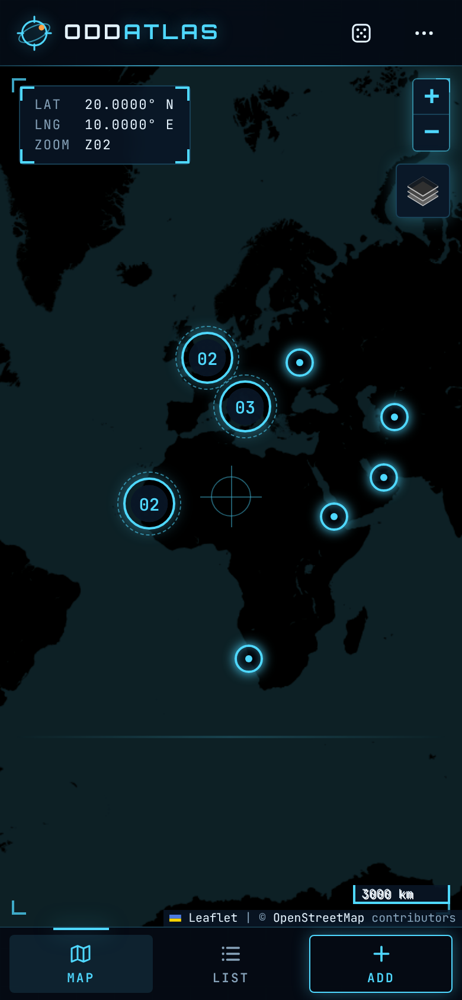
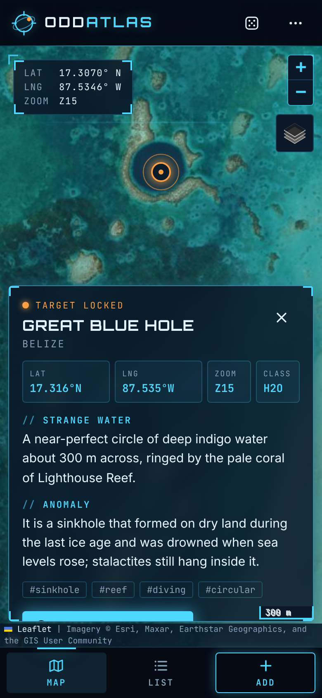
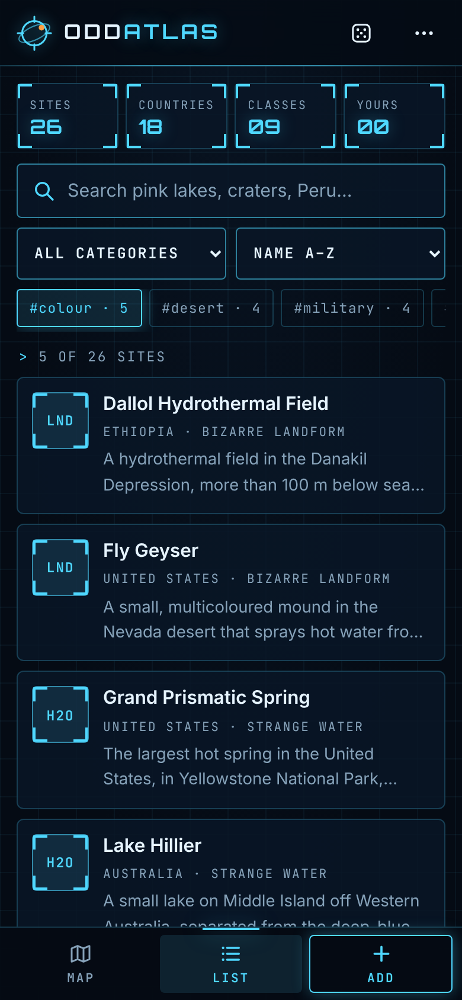
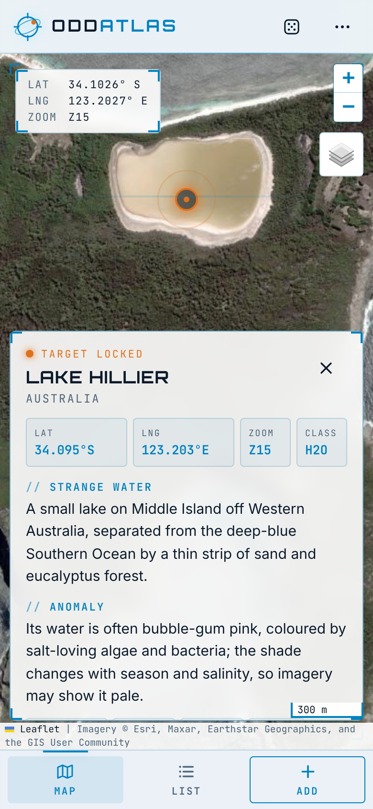
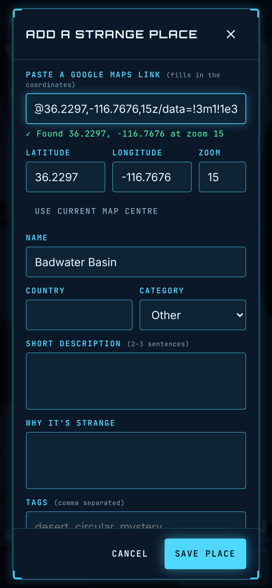
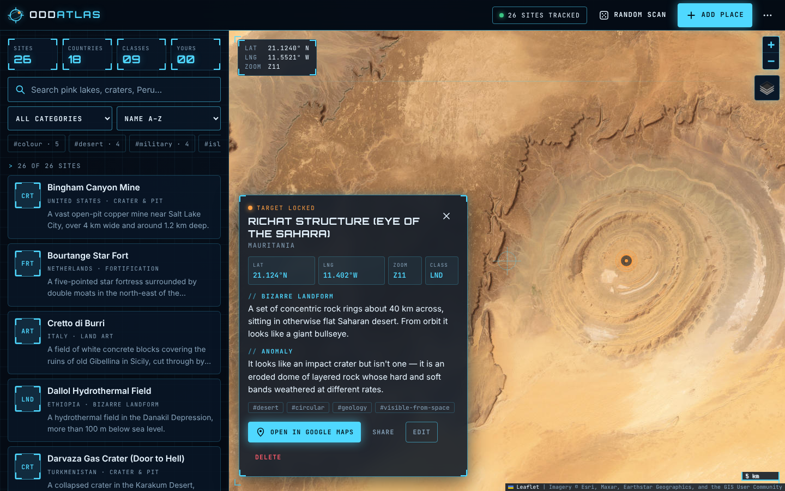

# OddAtlas

[](https://github.com/PavanIT1217/oddatlas/actions/workflows/ci.yml)
[](https://github.com/PavanIT1217/oddatlas/actions/workflows/deploy-pages.yml)

**A catalogue of strange, surprising places on Earth that you can browse on a map and keep adding to.**
Geoglyphs, bizarre landforms, abandoned structures, pink lakes, burning craters and mysterious
installations — every one visible from above. Live: **https://pavanit1217.github.io/oddatlas/**

Vite + TypeScript + Leaflet, OpenStreetMap tiles plus an Esri World Imagery satellite layer, no API keys
and no backend. Ships as a website, an installable PWA and iOS / Android apps (Capacitor).

| Map | Target card | List | Daylight theme | Add a place |
| --- | --- | --- | --- | --- |
|  |  |  |  |  |



## Features

- **Map** with clustered markers. Tapping one opens its card and flies to the spot at the right zoom in
  **satellite view** (Esri World Imagery; toggle back to OpenStreetMap any time).
- **List** with full-text search (accent-insensitive, across name, country, description and tags),
  category and tag filters, and sorting by name, newest, country, category or distance from the map centre.
- **Add, edit and delete** places. Paste a Google Maps link — `@lat,lng,17z`, satellite `…,850m` views,
  `/place/…/!3d…!4d…` pins, `?q=lat,lng`, or plain `lat, lng` — and the coordinates and zoom fill in.
  Changes are saved in `localStorage` as an overlay on the seed data, so new seed places still arrive.
- **Export / import** the whole catalogue as JSON (merge or replace), validated on the way in.
- **Random strange place** button.
- **Deep links**: `?place=richat-structure`.
- **HUD design**: a mission-control look — deep-space navy, cyan telemetry lines, corner brackets,
  a map crosshair with live LAT/LNG/ZOOM readout, "target locked" cards with coordinate tiles,
  three-letter class codes (`GEO`, `H2O`, `CRT`…) and catalogue telemetry tiles. Dark HUD by default,
  plus a **daylight** (light) variant and **auto** (follows the device); street tiles are re-tinted in dark mode.
- **Mobile-first** layout (bottom navigation, bottom-sheet card), side-by-side list + map on desktop.
- **SEO**: at build time the seed catalogue is baked into `index.html` as JSON-LD (`ItemList` of
  `TouristAttraction`s with coordinates) and a crawlable list; per-place URLs are in `sitemap.xml`.

## Getting started

```bash
npm install
npm run dev          # http://localhost:5173
npm run validate     # check data/places.json against the JSON Schema
npm test             # Vitest
npm run build        # validate + type-check + production build into dist/
```

Mobile: `npm run android` / `npm run ios`. Store publishing is automated by GitHub Actions — see
[docs/MOBILE_RELEASE.md](docs/MOBILE_RELEASE.md) and [docs/store-listing.md](docs/store-listing.md).

## Adding places by pull request

The shared catalogue lives in [`data/places.json`](data/places.json) and is validated against
[`schema/place.schema.json`](schema/place.schema.json) on every PR.

1. **Find it in satellite view** on Google Maps and zoom until the feature fills the screen.
   Copy the URL; you need the `@LAT,LNG,ZOOMz` part. (If you see `…,850m` instead of `…z`, the in-app
   "Add" form converts it for you — you can add the place in the app, **Export**, and copy the entry.)
2. **Add an object** to the array in `data/places.json`:

   ```json
   {
     "id": "richat-structure",
     "name": "Richat Structure (Eye of the Sahara)",
     "lat": 21.124,
     "lng": -11.4017,
     "country": "Mauritania",
     "category": "landform",
     "description": "Two or three sentences, in your own words, describing what you see.",
     "whyStrange": "One or two sentences on what makes it surprising.",
     "googleMapsUrl": "https://www.google.com/maps/@21.124,-11.4017,11z",
     "zoom": 11,
     "tags": ["desert", "circular", "geology"],
     "dateAdded": "2026-10-15"
   }
   ```

   | Field | Rules |
   | --- | --- |
   | `id` | unique kebab-case slug |
   | `lat`, `lng` | decimal degrees, pointing **at the feature** (≈5 decimals) |
   | `category` | `geoglyph`, `landform`, `water`, `abandoned`, `structure`, `installation`, `crater`, `artificial-island`, `fortification`, `art`, `other` |
   | `description`, `whyStrange` | 20–600 characters each, original wording |
   | `googleMapsUrl` | exactly `https://www.google.com/maps/@LAT,LNG,ZOOMz`, matching `lat`/`lng`/`zoom` |
   | `zoom` | 2–21, the level at which the feature is best seen |
   | `tags` | up to 12 unique kebab-case tags |
   | `dateAdded` | `YYYY-MM-DD` |

3. Run `npm run validate` (it also checks for duplicate ids, mismatched Maps links and entries within
   50 m of each other) and open a PR — the template has a short checklist. Not a coder?
   [Suggest a place in an issue](../../issues/new?template=suggest-a-place.yml).

## How the seed data was checked

Each of the 26 seed places was located from published coordinates or the OpenStreetMap feature, then
checked by rendering the Esri World Imagery tiles around the exact coordinate and confirming the feature
sits under the crosshair. Candidates that couldn't be confirmed in the imagery (for example faded
geoglyphs) were left out. The Nazca hummingbird is too small for the available imagery resolution;
its position comes from the OpenStreetMap-mapped geoglyph.

## Project structure

```
data/places.json         seed catalogue (the thing to edit in PRs)
schema/                  JSON Schema for places.json
scripts/                 validate-places.mjs (CI), screenshots, icons
src/
  core/place.ts          Place type, categories, helpers
  data/                  store.ts (seed + localStorage overlay, import/export), googleMaps.ts (URL parser),
                         query.ts (search/filter/sort), validate.ts (runtime validation)
  map/mapView.ts         Leaflet map, clustering, street/satellite layers
  ui/                    card, list, add/edit form, theme, DOM helpers
  platform/              file save / share (web + native)
tests/                   Vitest unit tests
android/ ios/            Capacitor native projects
.github/                 CI (schema validation, tests, build, Android), Pages deploy, store releases, templates
```

## Attribution

Map data © [OpenStreetMap](https://www.openstreetmap.org/copyright) contributors. Imagery © Esri, Maxar,
Earthstar Geographics and the GIS User Community. "Open in Google Maps" links go to Google Maps.

## Deployment

Pushing to `main` validates the data, runs the tests and deploys to GitHub Pages
(Settings → Pages → Source: **GitHub Actions**).

## License

[MIT](LICENSE)
